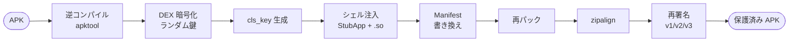

<div align="center">

# 🛡 zhidun

**Android APK 保護 — DEX 暗号化 · ネイティブシェルエンジン · 改ざん防止。**

[English](README.md)&nbsp;|&nbsp;日本語


[](https://github.com/zhidun2027/zhidun/releases/latest)

[ダウンロード](https://github.com/zhidun2027/zhidun/releases/latest) · [Webサイト](https://zhidun2027.github.io/zhidun/) · [クイックスタート](#クイックスタート) · [仕組み](#仕組み) · [実証](#実証)

</div>

---

Android アプリを「シェル」で包みます。元の DEX を暗号化して `assets` に隠し、実行時に `StubApp` とネイティブエンジンが復元します。解析者が手にするのはシェルだけで、あなたのコードではありません。**逆コンパイル → 暗号化 → 注入 → アライン → 再署名**を 1 コマンドで。

```console
$ zhidun protect ./app.apk --keystore release.jks
[✓] 逆コンパイル · apktool
[✓] 元 DEX を暗号化        → assets/nivye
[✓] cls_key を生成         dexKey / signa / ...
[✓] シェル + .so 注入      arm64 · v7a · x86_64 · mips64
[✓] Manifest 書き換え      com.youyou.shell.StubApp
[✓] zipalign + 再署名      v1 / v2 / v3
→ app_shell_sign.apk  保護完了
```

## 機能

- **DEX 暗号化** — 元の `classes.dex` を暗号化して `assets` に格納。APK 内に平文コードは残りません。独自ストリーム暗号、ビルドごとにランダム鍵。
- **ネイティブエンジン** — `libjiaguo.so` が 4 つの ABI（arm64-v8a, armeabi-v7a, x86_64, mips64）で動作。復号・整合性チェック・本来の `Application` への差し替えをネイティブ層で実行。
- **シェルローダー** — `StubApp` が `attachBaseContext` で `.so` を読み込み、`cls_key` から `dexKey` を導出、元の DEX を復元し、`RefInvoke` で本来のエントリへ差し替え。
- **アンチデバッグ** — `/proc/self/status` の `TracerPid` で `ptrace` を検知。ウォッチドッグスレッドが時間ドリフトを監視し、異常時は終了。
- **環境検知** — Root、Xposed / Substrate、HTTP プロキシ、VPN、マルチアカウント、USB デバッグ、開発者オプションを検知。
- **マルチスキーム署名** — apksig で再署名。JAR (v1) と APK Signature Scheme v2 / v3 に対応。

## 仕組み



実行時はシェルがこれを逆にたどります：`StubApp` → `libjiaguo.so` 読み込み → `cls_key` 読み取り → 元 DEX を復号 → `RefInvoke` で本来の `Application` へ。

## 実証

保護は、シェルが元アプリを復元できて初めて意味があります。それを証明します：ツール**自身**のアルゴリズムで保護済み APK をアンパックし、`cls_key` から `dexKey` を導出、埋め込まれた DEX を復号して元と比較します。

```text
元 dex     776 B   md5 7943a0e0964c227d5351bd4a7eccfd1b
復元 dex   776 B   md5 7943a0e0964c227d5351bd4a7eccfd1b
★ バイト単位で完全一致 — 可逆、シェルは元アプリを正しく復元します
```

パイプライン全体（逆コンパイル → 暗号化 → 注入 → 書き換え → 再パック → アライン → 署名）は実際の APK でエンドツーエンドに実行済みで、出力は `apksigner verify` の **v1 / v2 / v3** を通過します。

## クイックスタート

### ビルド済みダウンロード

[最新リリース](https://github.com/zhidun2027/zhidun/releases/latest)から入手できます。どちらも **Java 21**（[Temurin](https://adoptium.net/temurin/releases/?version=21)）が必要です：

- **Windows** — `zhidun.exe`、ダブルクリックで起動。
- **全 OS** — `zhidun-3.3.7-all.jar`、`java -jar zhidun-3.3.7-all.jar` で実行。

> `zhidun.exe` は未署名の [Launch4j](https://launch4j.sourceforge.net/) ラッパー（jar を内包）なので、一部のアンチウイルスが誤検知を表示する場合があります——中身は jar と同じコードです。

### ソースからビルド

**JDK 21** の Gradle プロジェクトです。

```bash
# GUI を起動（APK と keystore を選んで開始）
cd app
./gradlew run

# または単一の実行可能 jar をビルド
./gradlew fatJar
java -jar build/libs/*-all.jar
```

### 実行時の構成

ツールは作業ディレクトリ、または選択した APK の隣で `config.dll`（シェル資源パック）と `tools/` フォルダを探します：

```text
workdir/
├── config.dll              # シェル資源パック
└── tools/
    ├── apktool(.bat)       # Windows / Linux
    └── zipalign(.exe)
```

署名は**自分の** keystore で行ってください。Windows は `apktool.bat` + `zipalign.exe`、Linux は拡張子なし版を使用します。

## 技術仕様

| | |
|---|---|
| 暗号 | 独自ストリーム `^key ^3 -5` · MD5 · Base64 |
| DEX 鍵 | ビルドごとランダム、大ファイルは部分暗号化（先頭 2048 バイト） |
| シェルエントリ | `com.youyou.shell.StubApp` |
| ネイティブエンジン | `libjiaguo.so` × 4 ABI |
| 署名 | apksig v1 / v2 / v3 |
| UI | Java Swing · FlatLaf |
| プラットフォーム | Windows · Linux |

## ディレクトリ構成

```text
app/                 Java ソース — 保護ツール本体（Gradle, JDK 21）
index.html                ランディングページ（GitHub Pages のホーム）
docs/                   技術ドキュメント — 完全な逆解析レポート
shell-contents/        config.dll の展開内容（シェルペイロード、監査可能）
config.dll.decrypted.zip       復号済み config.dll（生の ZIP）
libjiaguo-decompiled.c    ネイティブエンジンの Ghidra 全量逆コンパイル（212 関数）
technical-manual.md             技術マニュアル
```

## 透明性

ブラックボックスなし——それが本リリースの目的です。ここにあるすべてのバイナリは文書化され、監査可能です：

- **`config.dll`** は暗号化された ZIP に過ぎません（`encrypt(zip, "2025_09")`）。その全内容は [`shell-contents/`](./shell-contents) に展開してあり——`StubApp` の smali、manifest、ABI ごとの `.so`——隠しペイロードがないことを確認できます。**コミットされた blob ではなくビルド成果物**です：[`build-config-dll.py`](./build-config-dll.py) の `build` で可視 ZIP から再生成、`verify` でバイト単位に検証できます（ツール内のパッカーは [`ConfigPacker.java`](./app/src/main/java/ConfigPacker.java)）。
- **`libjiaguo.so`**（ネイティブエンジン）は [`libjiaguo-decompiled.c`](./libjiaguo-decompiled.c) に全 212 関数を逆コンパイル済み。暗号化・アンチデバッグ・DEX ロードを行い、**ネットワーク通信もデータ送信も行いません**。
- 完全な解析——シェルの仕組み、暗号、全鍵、アンチデバッグと検知、そしてアンパック方法まで——は[ドキュメントサイト](./docs/index.html)と [`technical-manual.md`](./technical-manual.md) にあります。

これは破れない金庫ではなく実用的な難読化層なので、アンパック解析もあえて公開します。誇大広告より誠実さを。

## コントリビュート

技術リリースであり、アイデア・監査・PR を歓迎します。暗号はあえて単純です（ハードコード鍵の弱い XOR ストリーム暗号）ので、最も改善しやすい点です。取り組みやすい例：

- ハードコード鍵ではなく適切な鍵導出を伴う本物の暗号（AES/RSA）
- アンチ改ざん / 整合性チェックと実行時検知の追加
- 新しい Android と追加 ABI への対応
- よりクリーンでビルド可能なネイティブエンジン

Issue や PR をどうぞ——コードだけでなく、逆解析ノートやセキュリティ監査も同じく歓迎します。

## 連絡先

- Email: singhrubensingh@gmail.com
- Telegram: [@java2024](https://t.me/java2024)

## 免責事項

zhidun は Android アプリの**保護（ハードニング）**ツールであり、**自分が所有するアプリ**のコード資産を逆解析・改ざん・海賊版から守るためのものです。所有している、または明示的に変更の許可を得たアプリにのみ使用してください。悪用について作者は責任を負いません。

## ライセンス

MIT — [LICENSE](./LICENSE) を参照。同梱・依存する第三者コンポーネントはそれぞれのライセンスに従います（[THIRD-PARTY-NOTICES.md](./THIRD-PARTY-NOTICES.md)）。
