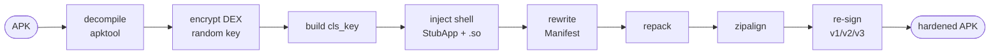

<div align="center">

# 🛡 zhidun

**Android APK hardening — DEX encryption · native shell engine · anti-tamper.**

English&nbsp;|&nbsp;[日本語](README.ja.md)


[](https://github.com/zhidun2027/zhidun/releases/latest)

[Download](https://github.com/zhidun2027/zhidun/releases/latest) · [Website](https://zhidun2027.github.io/zhidun/) · [Quick Start](#quick-start) · [How it works](#how-it-works) · [Verified](#verified)

</div>

---

Wrap your Android app in a shell. The original DEX is encrypted and hidden in `assets`, then restored at runtime by a `StubApp` and a native engine. Reverse engineers get a shell — not your code. One command runs **decompile → encrypt → inject → align → re-sign**.

```console
$ zhidun protect ./app.apk --keystore release.jks
[✓] decompile · apktool
[✓] encrypt original DEX   → assets/nivye
[✓] build cls_key          dexKey / signa / ...
[✓] inject shell + .so     arm64 · v7a · x86_64 · mips64
[✓] rewrite Manifest       com.youyou.shell.StubApp
[✓] zipalign + re-sign     v1 / v2 / v3
→ app_shell_sign.apk  hardened
```

## Features

- **DEX encryption** — the original `classes.dex` is packed, encrypted, and hidden in `assets`; no plaintext code remains in the APK. Custom stream cipher, a fresh random key per build.
- **Native engine** — `libjiaguo.so` runs across four ABIs (arm64-v8a, armeabi-v7a, x86_64, mips64). Decryption, integrity checks, and swapping back the real `Application` happen in native code.
- **Shell loader** — `StubApp` loads the `.so` in `attachBaseContext`, reads `cls_key` to derive the `dexKey`, restores the original DEX, and swaps the real entry back via `RefInvoke`.
- **Anti-debugging** — detects `ptrace` via `TracerPid` in `/proc/self/status`; a watchdog thread catches timing drift and exits on anomaly.
- **Environment detection** — flags root, Xposed / Substrate, HTTP proxy, VPN, app-cloning, USB debugging, and developer options.
- **Multi-scheme signing** — re-signs with apksig: JAR (v1) plus APK Signature Scheme v2 / v3.

## How it works



At runtime, the shell reverses it: `StubApp` → load `libjiaguo.so` → read `cls_key` → decrypt the original DEX → `RefInvoke` back to the real `Application`.

## Verified

Hardening is only useful if the shell can restore the original app. We prove it: unshell a hardened APK with the tool's **own** algorithm — derive the `dexKey` from `cls_key`, decrypt the embedded DEX, and compare it with the original.

```text
original dex   776 B   md5 7943a0e0964c227d5351bd4a7eccfd1b
recovered dex  776 B   md5 7943a0e0964c227d5351bd4a7eccfd1b
★ byte-for-byte identical — reversible, the shell restores the original app
```

The full pipeline (decompile → encrypt → inject → rewrite → repack → align → sign) has been run end-to-end on a real APK, and the output passes `apksigner verify` on **v1 / v2 / v3**.

## Quick Start

### Prebuilt downloads

Grab the [latest release](https://github.com/zhidun2027/zhidun/releases/latest). Both need **Java 21** ([Temurin](https://adoptium.net/temurin/releases/?version=21)) installed:

- **Windows** — `zhidun.exe`, double-click to run.
- **Any OS** — `zhidun-3.3.7-all.jar`, run `java -jar zhidun-3.3.7-all.jar`.

> `zhidun.exe` is an unsigned [Launch4j](https://launch4j.sourceforge.net/) wrapper around the jar, so some antivirus engines may show a false positive — the jar is the same code.

### Build from source

A Gradle project on **JDK 21**.

```bash
# launch the GUI (pick APK + keystore, hit start)
cd app
./gradlew run

# or build a single runnable jar
./gradlew fatJar
java -jar build/libs/*-all.jar
```

### Runtime setup

The tool looks for `config.dll` (the shell resource pack) and a `tools/` folder in the working directory or next to the chosen APK:

```text
workdir/
├── config.dll              # shell resource pack
└── tools/
    ├── apktool(.bat)       # Windows / Linux
    └── zipalign(.exe)
```

Sign with your **own** keystore. On Windows use `apktool.bat` + `zipalign.exe`; on Linux the extension-less versions.

## Tech spec

| | |
|---|---|
| Cipher | custom stream `^key ^3 -5` · MD5 · Base64 |
| DEX key | random per build, partial (first 2048 bytes) for large files |
| Shell entry | `com.youyou.shell.StubApp` |
| Native engine | `libjiaguo.so` × 4 ABI |
| Signing | apksig v1 / v2 / v3 |
| UI | Java Swing · FlatLaf |
| Platform | Windows · Linux |

## Project layout

```text
app/                 Java source — the hardening tool (Gradle, JDK 21)
index.html                landing page (GitHub Pages home)
docs/                   technical docs — the full reverse-engineering writeup
shell-contents/        extracted contents of config.dll (shell payload, auditable)
config.dll.decrypted.zip       decrypted config.dll (the raw ZIP)
libjiaguo-decompiled.c    full Ghidra decompilation of the native engine (212 funcs)
technical-manual.md             technical manual
```

## Transparency

No black box — that is the point of this release. Every binary here is documented and auditable:

- **`config.dll`** is just an encrypted ZIP (`encrypt(zip, "2025_09")`). Its full contents are extracted under [`shell-contents/`](./shell-contents) — the `StubApp` smali, the manifest, and the per-ABI `.so` — so you can confirm there is no hidden payload. It is a **build artifact, not a committed blob**: run [`build-config-dll.py`](./build-config-dll.py) `build` to regenerate it from the visible ZIP and `verify` to check it byte-for-byte (the in-tool packer is [`ConfigPacker.java`](./app/src/main/java/ConfigPacker.java)).
- **`libjiaguo.so`** (the native engine) is fully decompiled in [`libjiaguo-decompiled.c`](./libjiaguo-decompiled.c) — all 212 functions. It handles encryption, anti-debugging, and DEX loading, and makes **no network calls and exfiltrates no data**.
- The complete analysis — shell mechanism, cipher, every key, anti-debug and detection, even how to unpack it — is in the [documentation site](./docs/index.html) and [`technical-manual.md`](./technical-manual.md).

This is a practical obfuscation layer, not an unbreakable vault, so the unpacking analysis is published too. Honesty over snake oil.

## Contributing

A technical release — ideas, audits, and PRs are welcome. The cipher is intentionally simple (a weak XOR stream cipher with hardcoded keys), which is the most obvious thing to improve. Good starting points:

- A real cipher (AES/RSA) with proper key derivation instead of hardcoded keys
- More anti-tamper / integrity checks and runtime detection
- Newer Android and additional ABI support
- A cleaner, buildable native engine

Open an issue or a PR — reverse-engineering notes and security audits are as welcome as code.

## Contact

- Email: singhrubensingh@gmail.com
- Telegram: [@java2024](https://t.me/java2024)

## Disclaimer

zhidun is an Android app **hardening** tool, for protecting the code assets of **apps you own** against reverse engineering, tampering, and piracy. Use it only on applications you own or are explicitly authorized to modify. The authors are not responsible for misuse.

## License

MIT — see [LICENSE](./LICENSE). Bundled and dependent third-party components keep their own licenses; see [THIRD-PARTY-NOTICES.md](./THIRD-PARTY-NOTICES.md).
